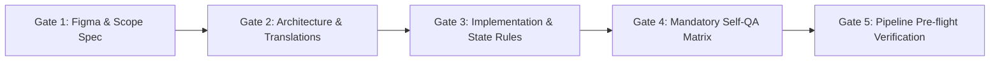

# TFS Frontend - Architecture, Review Standards & Guidelines

This document defines the strict, non-negotiable standards required for all development in the TFS Frontend workspace.

---

## 🚀 The 5-Gate Ticket Protocol (Mandatory for Every Ticket)

Every ticket/feature MUST strictly follow these 5 gates in order:

---

### Gate 1: Figma & Scope Spec (Pre-Coding Analysis)
- **Figma Node Mapping**: Explicitly inspect and list every screen, tab, modal, dropdown, and responsive state.
- **Layout & Width Specs**: Ensure full-width screen layouts and correct hierarchy (e.g. separate pages for complex chat/conversation vs compact detail cards).
- **Resolve Ambiguity First**: Never make blind assumptions on ambiguous designs—clarify with the user before writing code.

---

### Gate 2: Architecture & Translations First
- **Zero Hardcoding**: Add all UI text to `constants.ts`, `sv.ts`, and `en.ts` *before* building UI components.
- **Component Modularity**: Monolithic files (>150-200 lines) are strictly prohibited. Decompose into modular sub-components in dedicated folders.
- **Custom Hooks**: Extract state, form handlers, and data transformations into dedicated hooks (e.g. `useCaseForm`, `useCaseList`).

---

### Gate 3: State Management & UX Discipline
- **Clean Form Resets**: Create forms MUST always initialize with clean, empty states. Never leave stale or pre-filled dummy data on create flows.
- **Strict Multi-Tab / Multi-Step Validation**: Prevent saving incomplete records. Validate all required fields across all tabs before allowing submit.
- **Unique Identifiers**: Always use unique generated IDs (e.g. `doc_${Date.now()}_${index}`) for dynamic items and file attachments.
- **Safe State Mutations**: Add confirmation dialogs before irreversible or high-impact actions (e.g., delete, status transitions, credit invoice).
- **Predictable Navigation**: Ensure back buttons, breadcrumbs, and tab switches return cleanly without broken state.

---

### Gate 4: Mandatory Interactive Self-QA Matrix
Before marking any ticket or PR ready, run through the complete user journey:
1. **Create Flow**: Open blank -> Verify fields empty -> Attempt empty submit (verify inline errors) -> Fill fields -> Add files -> Save -> Verify item appears in list.
2. **Edit Flow**: Open existing record -> Verify fields populated accurately -> Edit fields -> Save -> Verify updates persisted.
3. **View / Detail Flow**: Inspect full layout -> Test tabs -> Verify responsive sizing -> Test action menus.
4. **Language Check**: Toggle between Swedish and English to ensure 100% localization coverage with zero missing keys.

---

### Gate 5: Pipeline Pre-flight Verification
Always run and pass all three commands locally before opening or updating a PR:
1. `pnpm --filter @tfs/professional typecheck` (Must pass with 0 errors)
2. `pnpm --filter @tfs/professional lint` (Must pass with 0 warnings/errors)
3. `pnpm --filter @tfs/professional build` (Must build production bundle cleanly)

---

## 📌 Edwin's Mandatory Review Checklist

### 1. Zero Hardcoding
- Move all storage keys (`localStorage`/`sessionStorage`) to `*.constants.ts`.
- Move all business defaults, fallbacks, and labels to `localizationConstants` (`constants.ts`, `sv.ts`, `en.ts`).
- Declare all financial and business numbers as named constants (e.g., `VAT_RATE = 0.25`).

### 2. Strict Localization (Swedish & English)
- Never mix Swedish and English terms in UI components.
- Any text added to `sv.ts` must have a matching English counterpart in `en.ts`.

### 3. Component Modularity
- Avoid monolithic TSX files (>150-200 lines). Break complex views into sub-components under a dedicated subdirectory.

### 4. Input Validation & Form UX
- Never save forms or partial updates directly without validating required fields.
- Show inline error messages for invalid fields.

### 5. Safe State Mutations
- Add confirmation dialogs before critical or irreversible actions (e.g. "Mark as Paid", "Credit Invoice", "Delete").

### 6. Security & Sensitive Data
- Do not store plain-text PII or financial data in `localStorage`. Use in-memory storage or secure encoding layers.

### 7. Performance (Hooks & Memoization)
- Keep `useMemo` dependency arrays granular (e.g., `[data?.lineItems]` instead of `[data]`).

---

## 📌 Bilal's Strict PR Review Criteria & Pre-PR Gate Checklist

Before opening any PR, verify compliance against [PR_REVIEW_CHECKLIST.md](file:///e:/Office/TFSfrontend/tfs-frontend/PR_REVIEW_CHECKLIST.md):

### 1. Derived State vs Stored Numbers
- **Never store calculated metrics**: Derivations (`total = sum()`, `percentage = Math.round(count / total * 100)`, `openTickets = tickets.length`, `daysLeft = diff(today, expiry)`) MUST be computed via `useMemo` in custom hooks.
- **Dynamic time deltas**: Never hardcode `daysLeft` or static `"1h sedan"`. Compute against `today` and format with localized relative time keys.
- **No fake refresh hooks**: Do not implement fake `setTimeout` spinners with dummy object mutations. Only provide `onRefresh` when backed by a real fetch.

### 2. Route Architecture & Canonical URLs
- **Single canonical route**: Never serve a dashboard at two paths (e.g. `/x` and `/x/dashboard`). Choose either the Economy pattern (base route) or Agreement pattern (redirect).
- **Tab highlighting**: Ensure the active route tab highlights correctly without broken navigation states.
- **Delete dead wrappers**: Remove redundant `*Page.tsx` or empty sub-route wrappers.

### 3. Zero Swedish in English UI & Formatters
- **Mock data language parity**: Timestamps must be ISO strings; mock subjects must be language-neutral English; mock lists must not contain Swedish nouns (e.g. "Skärmar").
- **Currency formatting**: Always use `formatCurrency()` from `@/utils/formatters`, never `.toLocaleString("sv-SE")`.
- **Quantity separation**: Quantities must come from the `quantity` field, never embedded in names like `"Item (x4)"`.
- **Swedish spelling & compound words**: Verify compound word spelling (e.g., "Inköp utrustning", "KPI Data-IT översikt").
- **Aria labels**: Always localize `ariaLabel` attributes (e.g. `t(localizationConstants.dataItAriaSections)`).
- **No duplicate keys**: Reuse existing keys (`documentCenterItem`, `archiveItem`). Prune unused keys before PR.

### 4. Component Decoupling & Widget Architecture
- **Zero data in TSX**: Never hardcode data lists or system status arrays in `.tsx` files; pass via props from `*.mock.ts`.
- **Strict TranslationKeys**: Type all translation keys with `TranslationKeys`, never `string`.
- **No string sniffing**: Use typed numeric properties instead of `.includes("%")`.
- **Status consistency**: Labels and statuses must never contradict (e.g., "Pending patches" cannot show "Operational").
- **Inline empty states**: Every collection widget must render an inline fallback when empty (`length === 0`).

### 5. UI Discipline & Honest Action Feedback
- **Semantic icons**: Never reuse the same icon for unrelated concepts (e.g. `Coins` for warranty and quick actions).
- **Honest feedback**: CTA buttons must navigate to the real destination or show a neutral "coming soon" toast—never a fake "success" toast.

### 6. PR Hygiene & Git Standards
- **Zero personal notes in `src/`**: Never commit checklists or scratch files inside `apps/*/src/...`.
- **Commit format**: Always prefix commits with `TFS-<TICKET_ID>: imperative summary`.
- **PR descriptions**: Accurately describe mock vs live status without claiming nonexistent live backend sources.

